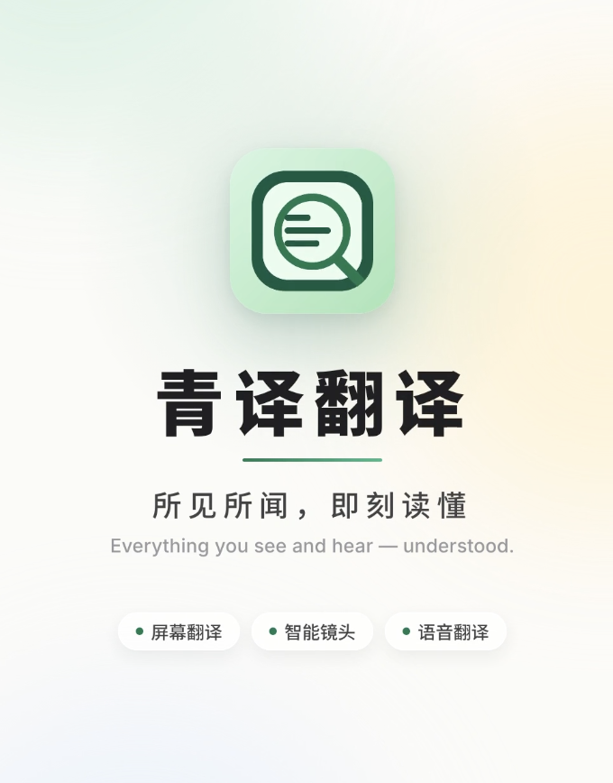
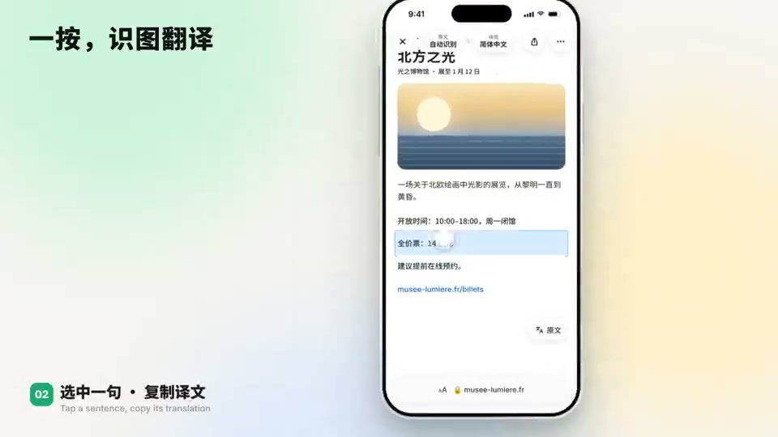

<p align="center">
  
</p>

<h1 align="center">Qingyi Translate · 青译翻译</h1>

<p align="center">
  Everything you see and hear — understood. An on-device translator for iPhone: screen translation, smart lens and live speech translation.<br>
  <a href="README.md">中文</a>
</p>

> **Status: personal prototype.** It builds and runs on a real iPhone, but it has not gone through full product QA and is not on the App Store. Behaviour across apps and iOS versions still needs real-device testing.

## Features

| Feature | Description |
|---|---|
| **Screen translation** | Captures the screen you choose to share via a ReplayKit broadcast, runs Vision OCR and translation on device, and shows the result live in a Picture-in-Picture window — either overlaid in place or as large subtitles. Translate the whole screen or a fixed region. |
| **Smart lens** | Import a photo, clipboard image, shared image, or use the Shortcuts flow "Take Screenshot → Recognize with Qingyi". Translations are drawn in place on the image; tap a sentence, copy source or translation, save the translated image, or use native VisionKit text selection. |
| **Speech translation** | Microphone or in-device audio (ReplayKit) → on-device speech recognition → translation, shown as continuously scrolling PiP subtitles with adjustable size, aspect and bilingual mode. |
| **Two engines** | Google ML Kit offline translation by default (fast; about 30 MB per language, downloaded on first use), or Apple's system Translation framework (more accurate), switchable in Settings. |
| **Themes** | Several UI themes (native, clear glass, warm mist glass, soft light, playful, mist) with custom wallpapers. |
| **Entry points** | Home Screen widget, "Send to Qingyi" share extension, App Intents for Shortcuts. |

14 languages: Simplified Chinese, English, Japanese, Korean, French, German, Spanish, Italian, Portuguese, Russian, Arabic, Thai, Vietnamese, Indonesian. Which pairs actually work depends on the engine and the system.

<p align="center">
  
  <br><sub>Smart lens demo (frame from the promo video; the page content is a fictional example)</sub>
</p>

## Requirements

- iPhone running **iOS 26.0 or later** (uses iOS 26 APIs such as `TranslationSession(installedSource:target:)`)
- Mac with **Xcode 26** or later
- An Apple ID (a free account can sign automatically, but free-signed apps must be reinstalled about every 7 days)
- Network access to Google / GitHub for the first ML Kit model download and Swift Package resolution

> Apple Translation and Picture-in-Picture do not work properly in the iOS Simulator. Test translation and screen features on a real device.

## Building

1. Clone the repo, open `iOS/Lingjing.xcodeproj` in Xcode and wait for Swift Packages to resolve.
2. In **Signing & Capabilities** for all four targets (`Lingjing`, `LingjingBroadcast`, `LingjingShare`, `LingjingWidget`), select your own Team.
3. **Change the bundle identifiers and App Group.** `com.liu.lingjing.translate` is already registered by the original author, so replace the prefix with your own in all of these places:
   - `PRODUCT_BUNDLE_IDENTIFIER` of the four targets (extensions must start with the main app's ID)
   - the App Group `group.com.liu.lingjing.translate` in the three `.entitlements` files
   - `sharedGroup` and `preferredExtension` in `iOS/Lingjing/Screen.swift`
   - `group` in `iOS/LingjingBroadcast/SampleHandler.swift`
4. Select your iPhone, enable Developer Mode on the device and press Run.
5. First run: pick source and target languages in Settings and download the models; translation then works offline.

Command-line build check (no signing):

```sh
xcodebuild -project iOS/Lingjing.xcodeproj -scheme Lingjing \
  -configuration Debug -destination 'generic/platform=iOS' \
  CODE_SIGNING_ALLOWED=NO build
```

ML Kit's `MLKitTranslate_resource.bundle` is not stored in this repo. The **Copy ML Kit resources** build phase copies it into the app at build time from the `MLKitTranslate.framework` provided by the Swift Package.

## Project layout

```text
iOS/Lingjing.xcodeproj      Xcode project
iOS/Lingjing/               Main app: SwiftUI UI, OCR, translation engines, smart lens, speech, PiP, themes
iOS/LingjingBroadcast/      ReplayKit broadcast upload extension (screen frames and audio you choose to share)
iOS/LingjingShare/          Share extension for importing images
iOS/LingjingWidget/         WidgetKit widget
docs/images/                Images for the README
```

## Privacy

- OCR, speech recognition and translation run on device. The app does not upload screen frames, images or audio, and has no accounts or ads. The app's own code contains no analytics.
- Network is used only to download ML Kit / Apple translation models, and to open a Google search page when you tap "Search" in the smart lens. Network behaviour of the ML Kit SDK itself is governed by Google's documentation.
- The broadcast extension keeps only the latest temporary frame in the App Group container; each frame overwrites the previous one and is deleted when the broadcast ends. Everything on screen is captured while broadcasting, so stop sharing on password or payment screens.

## Third-party components and licences

See [THIRD_PARTY_NOTICES.md](THIRD_PARTY_NOTICES.md). In short:

- **Google ML Kit** (translation, barcode scanning) is fetched at build time through the Swift Package [d-date/google-mlkit-swiftpm](https://github.com/d-date/google-mlkit-swiftpm). It is not included in this repo and is subject to the [ML Kit Terms of Service](https://developers.google.com/ml-kit/terms). Translation models are downloaded from Google at runtime.
- Apple system frameworks (Vision, Translation, Speech, ReplayKit, AVKit, …) are provided by iOS; no Apple system assets are included in this repo.
- The app icon, wallpaper and README images were made for this project.

## License

[MIT](LICENSE). The licence covers the code and assets in this repository only, not the third-party SDKs and services listed above.
