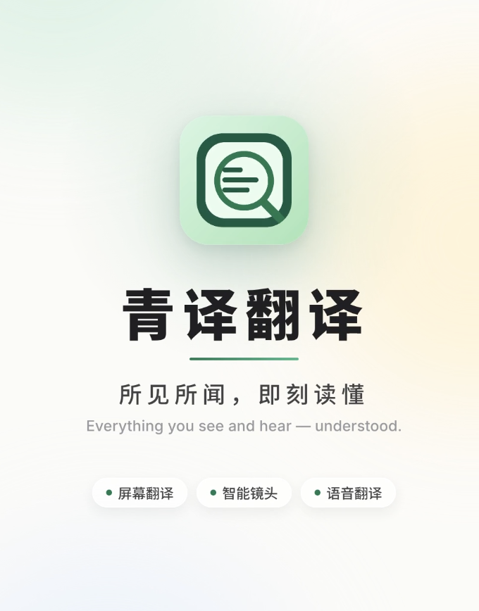
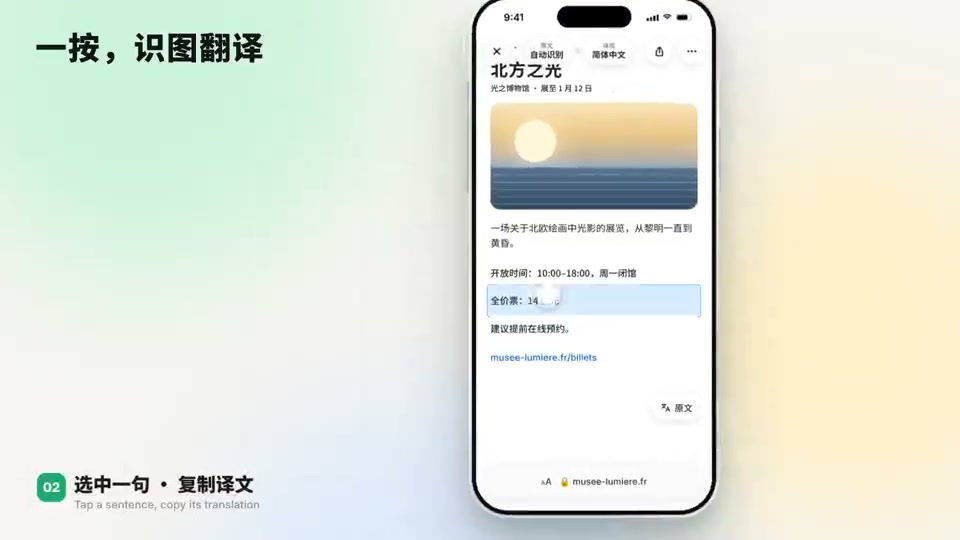

<p align="center">
  
</p>

<h1 align="center">青译翻译 · Qingyi Translate</h1>

<p align="center">
  所见所闻，即刻读懂。一款 iPhone 本机翻译 App：屏幕翻译、智能镜头、语音翻译。<br>
  <a href="README.en.md">English</a>
</p>

> **状态：个人技术原型。** 可以编译、安装到真机使用，但没有经过完整的产品验收，也没有上架 App Store。部分功能在不同 App、不同系统版本上的表现仍需要实测。

## 功能

| 功能 | 说明 |
|---|---|
| **屏幕翻译** | 通过 ReplayKit 屏幕广播采集你授权的画面，本机做 Vision OCR 和翻译，用画中画小窗实时显示译文。可以贴回原位或显示成大字幕；范围可选整个屏幕或框选固定区域。 |
| **智能镜头** | 导入照片、剪贴板图片、分享过来的图片，或用快捷指令「截屏 → 用青译识别图片」。原图上原位显示译文，可点选单句、复制原文或译文、保存译图；支持 VisionKit 原生文字选择。 |
| **语音翻译** | 麦克风或手机内部声音（ReplayKit）→ 本机语音识别 → 翻译，字幕以画中画方式显示并持续累积，可调字号、比例和双语显示。 |
| **两种翻译引擎** | 默认 Google ML Kit 离线翻译（速度快，每种语言约 30 MB 模型，首次使用时下载）；设置里可切换为苹果系统 Translation（更准确）。 |
| **多主题** | 原生简洁、清透玻璃、暖雾玻璃、柔光、彩趣、雾面等界面主题，支持自定义壁纸。 |
| **其他入口** | 主屏幕小组件、系统分享扩展「发送到青译」、App Intents 快捷指令。 |

支持 14 种语言：简体中文、英语、日语、韩语、法语、德语、西班牙语、意大利语、葡萄牙语、俄语、阿拉伯语、泰语、越南语、印尼语。实际可用的语言对以引擎和系统返回结果为准。

<p align="center">
  
  <br><sub>智能镜头演示（来自宣传片画面，页面内容为虚构示例）</sub>
</p>

## 系统要求

- iPhone，**iOS 26.0 或更高**（用到了 iOS 26 的 `TranslationSession(installedSource:target:)` 等接口）
- Mac + **Xcode 26** 或更高
- 一个 Apple ID（免费账号即可自动签名，但免费签名的 App 约 7 天需要重新安装）
- 首次下载 ML Kit 语言模型和 Swift Package 依赖需要能访问 Google / GitHub 的网络

> 苹果 Translation 和画中画不能在 iOS 模拟器里正常工作，翻译和屏幕功能请在真机上测试。

## 构建方法

1. 克隆仓库，用 Xcode 打开 `iOS/Lingjing.xcodeproj`，等待 Swift Package 依赖解析完成。
2. 在四个 Target（`Lingjing`、`LingjingBroadcast`、`LingjingShare`、`LingjingWidget`）的 **Signing & Capabilities** 里选择你自己的 Team。
3. **修改包标识符和 App Group**：仓库里的 `com.liu.lingjing.translate` 已被原作者占用，你需要换成自己的前缀，并一起修改以下位置：
   - 四个 Target 的 `PRODUCT_BUNDLE_IDENTIFIER`（扩展必须以主 App 的 ID 开头）
   - 三个 `.entitlements` 文件里的 App Group：`group.com.liu.lingjing.translate`
   - `iOS/Lingjing/Screen.swift` 里的 `sharedGroup` 和 `preferredExtension`
   - `iOS/LingjingBroadcast/SampleHandler.swift` 里的 `group`
4. 选择你的 iPhone，打开设备上的开发者模式，点 Run。
5. 首次使用：在设置里选择原文和目标语言，下载语言模型后即可离线翻译。

命令行编译检查（不签名）：

```sh
xcodebuild -project iOS/Lingjing.xcodeproj -scheme Lingjing \
  -configuration Debug -destination 'generic/platform=iOS' \
  CODE_SIGNING_ALLOWED=NO build
```

ML Kit 的 `MLKitTranslate_resource.bundle` 不放在仓库里：工程里的 **Copy ML Kit resources** 构建步骤会在编译时从 Swift Package 提供的 `MLKitTranslate.framework` 里把它复制进 App。

## 工程结构

```text
iOS/Lingjing.xcodeproj      Xcode 工程
iOS/Lingjing/               主 App：SwiftUI 界面、OCR、翻译引擎、智能镜头、语音、画中画、主题
iOS/LingjingBroadcast/      ReplayKit 广播上传扩展，采集你授权的屏幕画面和声音
iOS/LingjingShare/          系统分享扩展，导入图片
iOS/LingjingWidget/         WidgetKit 小组件
docs/images/                README 用图
```

## 隐私

- OCR、语音识别和翻译都在设备上完成，App 不上传屏幕画面、图片或语音，也没有账号和广告，App 自己的代码里没有任何统计上报。
- 网络只用于：下载 ML Kit / 苹果翻译语言模型；在智能镜头里点「搜索」时打开 Google 搜索页。ML Kit SDK 自身的网络行为以 Google 的说明为准。
- 广播扩展只在 App Group 容器里保留最新一帧临时图片，下一帧覆盖，结束时删除。广播期间屏幕上的所有内容都会被采集，请在密码、支付等敏感页面停止共享。

## 第三方资源与授权

见 [THIRD_PARTY_NOTICES.md](THIRD_PARTY_NOTICES.md)。简要说明：

- **Google ML Kit**（翻译、条码扫描）通过 Swift Package [d-date/google-mlkit-swiftpm](https://github.com/d-date/google-mlkit-swiftpm) 在构建时下载，不包含在本仓库里，使用须遵守 [ML Kit 服务条款](https://developers.google.com/ml-kit/terms)。翻译模型在运行时由 Google 下载。
- 苹果系统框架（Vision、Translation、Speech、ReplayKit、AVKit 等）由 iOS 提供，本仓库不包含任何苹果的系统资源。
- App 图标、壁纸和 README 图片为本项目自制。

## 许可证

[MIT](LICENSE)。许可证只覆盖本仓库里的代码和资源，不覆盖上面提到的第三方 SDK 和服务。
